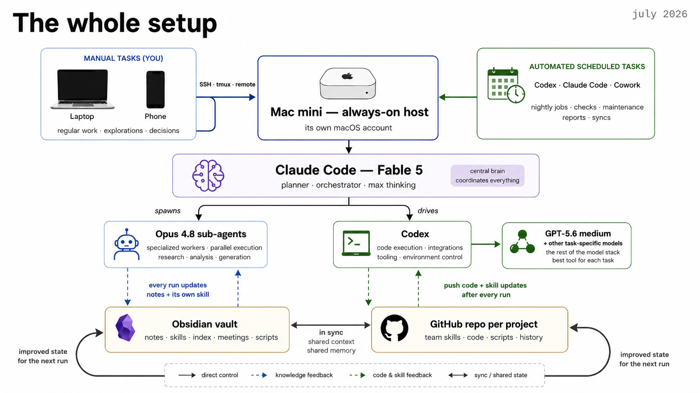

# Obsidian Agent Vault Template

A ready-to-use **Obsidian vault** that keeps the context around your AI skills—not
just isolated prompts. It puts reusable **skills** beside the **notes, meetings,
decisions, and feedback** they depend on, so Claude, Codex, or whatever comes next
can work from the same source of truth.

Based on the working vault of [Louis-François Bouchard](https://www.louisbouchard.ai/)
(Towards AI / What's AI), genericized so anyone can clone it and start.

This repository accompanies the O'Reilly talk **Agent-Agnostic Skills (Setup)
That Travel With Your Notes**. [View the course slides](https://docs.google.com/presentation/d/1yAk6CxxERokG2Fy-be7uBiLhrCqAuy9F7l25aoxrIdI/edit?usp=sharing).

## What this is

This is not one giant skill and it is not a new agent framework. It is the
portable, file-based layer that comes **with** your skills:

- **Knowledge:** the notes and decisions that ground an agent's work.
- **Capabilities:** small, focused skills that explain how to do recurring jobs.
- **Routing:** an index that tells the agent what to load instead of dumping the
  entire vault into every prompt.
- **Memory:** feedback files that preserve corrections and turn repeated lessons
  into better defaults.
- **Shared state:** plain Markdown that can sync across devices and be versioned
  or reviewed with Git.

The goal is to make the harness swappable. Important context should not disappear
because you changed models, tools, projects, laptops, or teammates.

## The setup in context



*The full setup shown in the course, July 2026. The specific models, Mac mini,
remote access, and schedulers are one example deployment—not requirements for
using this template.*

At its simplest, you only need the vault and an agent that can read files. A more
complete setup can add:

- **Obsidian Sync or another file sync** so the same knowledge is available from
  a phone, laptop, Windows machine, or always-on host.
- **A GitHub repo per project** for team skills, code, scripts, review history,
  and rollback. Personal experiments can graduate from the vault into a shared
  repo when they become reliable.
- **Scheduled runs** for recurring knowledge work such as research, analytics,
  meeting recaps, reports, and maintenance.
- **An isolated always-on account or machine** when automations must keep running
  after your laptop closes. Give it access only to the work resources it needs.

The durable loop is the same at every scale: **read the index and relevant state →
do the work → write the result and feedback back → start the next run from an
improved state.**

## Get it

```bash
git clone https://github.com/louisfb01/obsidian-agent-vault-template.git
```

Or click **Code → Download ZIP** above. Then in Obsidian:
**Open folder as vault → pick this folder.** That's the whole install — a vault is
just a folder of markdown files, so there is nothing to run and you can read every
file as plain text first.

The **Templates** core plugin comes pre-configured (pointed at `Templates/`), so
one-click note scaffolds work immediately — *Command palette → Insert template*.

## What's inside

```
START-HERE.md      ← open this first in Obsidian
AGENT-RULES.md     ← every agent reads this first: folder map, ownership, note rules, feedback loop
CLAUDE.md          ← one-line pointer so Claude Code loads AGENT-RULES.md
AGENTS.md          ← pointer so Codex and other agents load AGENT-RULES.md
Skills/            ← the "AI-OS": one folder per skill
  Skills Index.md  ← the map: which skill to load, layered hierarchy
  example-voice/   ← a worked example; copy it to make your own skill
    SKILL.md       ← what the skill does (source of truth)
    FEEDBACK.md    ← the skill's self-improvement log
  scheduled-runs/  ← what every scheduled run shares: start, browser, report, cleanup
  html-prototypes/ ← quick single-file HTML pages, prototypes and tools (artifacts, hosted sites)
  vault-maintenance/ ← weekly health run: hubs, links, orphans, rules health, skill health
Areas/             ← your real notes: one hub per area, one folder per project
  Professional/example-project/  ← index.md + progress-log.md pattern
working-dir/       ← agent scratch: task folders, research projects
  agent-log/       ← one line per agent run, shared by every agent
Templates/         ← scaffolds: project index, progress log, skill, feedback, task, scheduled-task prompt
_archive/          ← stale notes, kept not deleted
```

## The idea

- **One contract for every agent.** `AGENT-RULES.md` holds the folder map, who owns what, how
  notes are written, the feedback loop and the end-of-run checklist. `CLAUDE.md` and
  `AGENTS.md` only point to it, so whichever harness opens the vault reads the same rules.
  Only §1 (your folder map) is yours to fill in; §0 and §2 to §9 are general rules you can
  keep as they are.
- **Skills are capabilities.** Each `SKILL.md` tells the agent how to do one job.
  `Skills Index.md` maps them, layered **grounding → voice → research → output**,
  so a task combines only the context and capability it needs.
- **Notes are grounding.** `Areas/` holds your real notes. Skills read facts from
  here and write finished work back; they never invent what is not written.
- **The feedback loop is the point.** Every skill has a `FEEDBACK.md`. After each
  run the agent logs what worked and what you corrected. When a correction
  repeats, it gets *promoted* into `SKILL.md` as a new default. Lessons live in the
  vault, not in one agent's private memory, so they survive a change of model or tool.
- **Projects resume themselves.** Work that spans sessions gets a folder with an
  `index.md` (current version first, open items, a `## For agents` section) and a
  `progress-log.md`. A new session reads those two notes and continues.
- **Notes are written for a future agent.** Agent-written notes carry a small frontmatter
  block (`type`, `status`, `created`, `updated`, `summary`, `tags`), date the facts that change
  `(as of YYYY-MM-DD)`, keep sources verbatim and use full-path wikilinks. Adapted in part
  from the [AI-First Note Spec](https://github.com/eugeniughelbur/obsidian-second-brain/blob/main/AI-FIRST.md).
- **Agents see each other's work.** Every run that writes to the vault adds one line to
  `working-dir/agent-log/YYYY-MM.md`, so Claude Code, Codex and scheduled runs know what
  the others did.
- **Scheduled tasks run skills.** A scheduled task's prompt only says which skill to run, where
  its state lives and what to do if the vault cannot be read (`Templates/Scheduled task prompt.md`).
  The procedure lives in the skill, so it improves through the same feedback loop as everything
  else. `Skills/scheduled-runs/` holds what every unattended run shares.
- **The vault maintains itself.** `Skills/vault-maintenance/` runs weekly from any scheduler:
  it keeps hubs and links current, finds orphans, and reports where the rules are not
  followed, without rewriting your notes. It also grades how your skills did in the week's
  Claude Code and Codex sessions (adapted from Warp's skill-doctor) and drafts skill edits
  for you to approve.
- **Code stays external.** The vault holds notes and skills, plus small helper scripts a
  skill needs. Real code lives in its own Git repo, where teammates can review both the
  code and the shared skills that produced it. Never commit secrets.

## Setup (5 minutes)

1. *Open folder as vault* in Obsidian.
2. Fill in the owner line and the folder map in `AGENT-RULES.md` §1. Rename the `Areas/`
   folders to match your life and drop in your notes.
3. Copy `Skills/example-voice/` to make your first real skill; add its block to
   `Skills Index.md`.
4. Point your agents at the vault. Started inside the vault folder, Claude Code and Codex
   load `CLAUDE.md` / `AGENTS.md` on their own. To reach it from any folder, add this to
   `~/.claude/CLAUDE.md` and `~/.codex/AGENTS.md` (change the path):

   ```markdown
   # My Obsidian vault

   - Path: `~/path/to/vault`.
   - Before reading from or writing to it, read `AGENT-RULES.md` at its root. Skills index: `Skills/Skills Index.md`.
   - When you use one of its skills, log the run in that skill's `FEEDBACK.md`. Lessons that should outlive this session go in the vault, not only in this agent's memory.
   ```
5. Optional: schedule `Skills/vault-maintenance/SKILL.md` weekly in whatever runs your
   agents on a timer. Paste `Templates/Scheduled task prompt.md` into the scheduler instead
   of the procedure, and add the task to the table in `AGENT-RULES.md` §1.

## License

MIT — see [LICENSE](LICENSE). Reuse and adapt freely.
